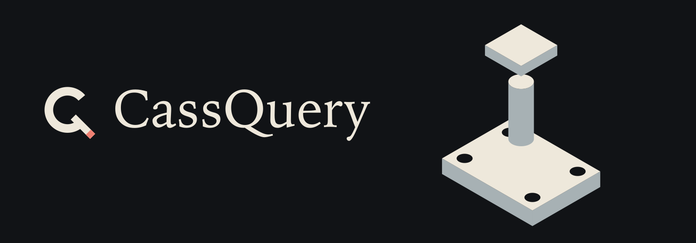
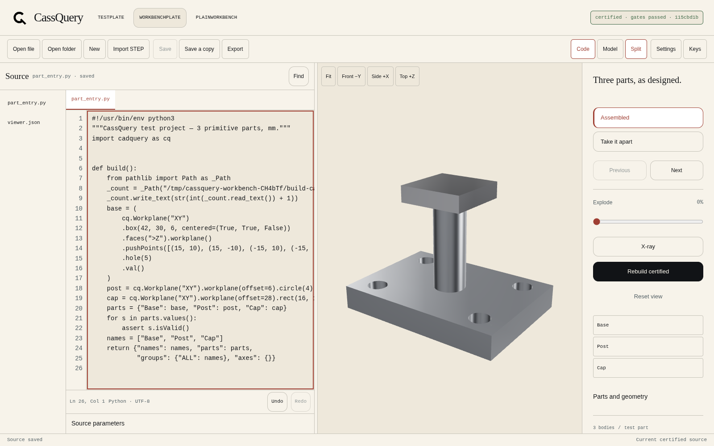

# CassQuery

<picture>
  <source media="(prefers-color-scheme: light)" srcset="branding/readme-light.svg">
  
</picture>

A local CadQuery workbench: edit Python, change source-backed parameters and part transforms, inspect certified solids, and export the geometry that was actually checked. The viewer remains available directly in a browser; filesystem editing and updates use the restricted desktop boundary.

CassQuery was built for parametric jewelry design, where one project is a chain of interdependent parts and the honest way to check a change is to *look at it*: posed, sectioned, X-rayed, measured. It is a personal tool, built in the open.



*Actual v0.2 source browser/worker test: Python editing and a newly certified model.
The desktop chooser in this source test is simulated; it is not native macOS dialog
or updater-install proof. v0.2 release qualification is still in progress.*

## Why it exists

The standard CadQuery viewers get their "live" feel from re-executing your script and re-sending the model. On a real project that re-execution *is* the product's own build chain — session verification, STEP exports, nested runs — and it costs tens of seconds per edit. The viewer isn't slow; the round trip is.

CassQuery splits the round trip in two:

- **Preview tier** — a build-only entry point per project (shapes, nothing else) tessellated coarse and pushed the moment a file changes. Fast, and labelled PREVIEW on screen so it is never mistaken for the truth.
- **Certified tier** — the full gate suite (below) on demand. Only certified models carry authored step states, measurements, and spec data. If a certified build fails its gates, the last certified model stays on screen.

## What it does

- **Named geometry payloads.** Parts arrive with stable names, packed triangle geometry and per-part finishes. Picking and visibility work on those named parts; payloads do not preserve BREP face/edge topology or provide CAD face-level editing.
- **Units and geometry gates on certified payloads.** Certified builds check source-versus-mesh extents, volume, closure, triangulation and encoding. Previews are deliberately ungated and visibly labelled; they are not manufacturing truth.
- **Authored steps.** A project can declare posed states — a joint bent, a component drawn out, an exploded view, an X-ray ghost — and the viewer steps through them instantly, because they are certified builds, not re-poses.
- **Camera that respects you.** Rebuilds keep your camera direction by default (`keep` mode); the model updates, your viewpoint doesn't get confiscated.
- **Finishes per part.** Brushed, polished, per material — assigned in the project manifest, applied in the payload.
- **An agent protocol on loopback.** The same worker serves a small local API — rebuild, status, gate results as data, body list, set step/camera, screenshot — so an AI assistant can drive the viewer and verify its own work against the gates instead of admiring a render.

## v0.2 workbench

- Open project folders, trusted Python files, or import STEP into an editable project.
- Edit actual Python/JSON files, find text, indent, undo/redo, and recover unsaved drafts.
- Change supported top-level scalar parameters and named-part BREP transforms.
- Inspect exact certified BREP bounds, volume and surface area. Camera/explode/hide
  are display-only; stale or failed geometry cannot masquerade as a current export.
- Export STEP/STP, STL, BREP, project ZIP, or an explicit Python copy. STEP imports
  do not reconstruct parametric history; source ZIP preserves the editable project.
- Eight offline themes and persistent editor/build/update settings.
- Cmd/Ctrl+O open, Shift+O folder, N new, S save, Shift+S copy, F find, B rebuild,
  E export, comma settings, Z/Shift+Z undo/redo. Model-view keys are focus-safe.
- Stable GitHub release checks and optional downloads; explicit custom restart/install
  requires a verified update and a writable user-owned installation. See [UPDATES.md](docs/UPDATES.md).

Source behavior has been exercised; native dialog/package/update qualification is
still pending. Contracts, limits and proof distinctions: [WORKBENCH.md](docs/WORKBENCH.md),
[WORKBENCH_ASSURANCE.md](docs/WORKBENCH_ASSURANCE.md), and [AUDIT.md](docs/AUDIT.md).

## Viewer controls

- **Orbit, pan, zoom** — drag, right-drag, and scroll (or pinch) on the stage. **Reset view** reframes the whole model, on wide and portrait stages alike.
- **Steps** — the step list, the Previous / Next buttons, or the **←** / **→** arrow keys walk the project's authored steps.
- **Click a part** to name it, then **Isolate**, **Hide**, or **Show all**. A click that turns into an orbit drag selects nothing.
- **Explode** — a slider that separates the parts along the project's declared explode vectors.
- **X-ray** — ghosts the parts the manifest marks as X-ray parts, so internals read through the shell.
- **Rebuild certified** — queues a full gated build. The badge and build line report progress, failure, and gate results; the tier on screen is never ambiguous.

## Architecture

```
CadQuery project ──► worker.py ──► semantic payload ──► viewer (three.js)
  viewer.json          warm Python     {name, hash}          │
  entry (build-only)   watcher +       announce over         └── Electron shell
                       build thread    local websocket       (spawns the worker)
```

- `worker.py` — one warm process: file watcher, build thread, HTTP server for the viewer and payloads, websocket announce, and the agent protocol. A failed build announces nothing; the last good payload is retained.
- `viewer/` — the three.js frontend (vendored three.js in `viewer/vendor/`), including the step player, per-part visibility, X-ray display and finish rendering.
- `shell/` — a thin Electron shell that spawns the worker and hosts the viewer. The viewer also runs in any modern browser against the worker directly.
- `testpart/` — a trivial public demo project (a plate with holes and a boss) with its manifest, used to prove the loop end to end.
- `payloads/` — generated payloads. The TESTPLATE payloads are committed as a fixture; other projects' payloads are generated locally and are not committed.
- `docs/` — the screenshot at the top of this README: the viewer running the demo project.

## Agent protocol

The worker serves a small HTTP API on loopback, plus a websocket on the HTTP port + 1000 that announces new payloads and state changes:

- `GET /api/projects` — an array of project statuses.
- `GET /api/status` — `{api_version, projects, load_errors}`: every project's status, plus the projects skipped at startup and why. `GET /api/status?project=NAME` returns that project's status alone.
- `GET /api/manifest?project=NAME` — the project's `viewer.json` manifest, as the viewer loads it.
- `GET /api/gates?project=NAME` — the latest certified gate results as data.
- `GET /api/parts?project=NAME` — per-part volumes, solid counts, centres, and bounding boxes.
- `POST /api/rebuild` with `{project, tier}` — queue a preview or certified build.
- `POST /api/view` — drive the open viewer: step, camera, variant, explode, X-ray.
- `POST /api/screenshot` — ask the open viewer for a PNG of the stage.

**Status shape change:** in v1, `GET /api/status` with no `project` returned a bare array of project statuses. It now returns the object above, so `load_errors` travels with the statuses. The `api_version` field (currently `2`) marks the shape — check it rather than guessing from the payload.

## Projects

A project is any directory with:

- a **build-only entry** — a Python module that builds and returns the project's shapes, without session verification, exports, or other side effects;
- a **`viewer.json`** manifest naming the entry, the project's class (`live` for fast projects, `on-demand` for slow ones whose steps are built when asked), its authored steps, and per-part finishes.

## Run it

Requirements for development: Python with CadQuery 2.5+ and websockets 13+, Node.js 22+.
The native macOS candidate bundles its own Python/CadQuery runtime; see
[macOS build and release gates](docs/MACOS_RELEASE.md).

### Try the demo

```bash
git clone https://github.com/cass-ale/CassQuery.git
cd CassQuery
python3 -m venv .venv
.venv/bin/pip install "cadquery>=2.5" websockets   # Windows: .venv\Scripts\pip
npm install
npm run app
```

The shell opens on the bundled demo project (`testpart/`, a plate with holes and a boss) with zero configuration: it finds the repo-local `.venv` in development, or the bundled worker inside the macOS app, and the first certified build runs on its own. `CASSQUERY_PYTHON` explicitly overrides the interpreter; `CASSQUERY_PROJECTS` (os.pathsep-separated — `;` on Windows, `:` elsewhere) replaces the demo with your own projects. The shell owns its worker process, follows its private PID-bound readiness registry to the actual selected port, and shuts it down on Quit. On macOS, closing the window keeps the app running; its Dock icon reopens the viewer.

### Run the worker directly

```bash
# project directories as arguments…
.venv/bin/python worker.py /path/to/projectA /path/to/projectB

# …or by environment
CASSQUERY_PROJECTS=/path/to/projectA:/path/to/projectB .venv/bin/python worker.py

# neither → the bundled testpart demo is served, and the worker says so
```

Then open the viewer at the URL the worker prints. The port is **3939** unless it is busy — the worker scans upward for a free port, prints the one it took, and writes `{port, pid}` to `~/.cassquery.json`, which is how the shell (and agents) find a running worker. `--port N` or `CASSQUERY_PORT=N` pins a starting port. With no arguments at all the worker still serves: the demo appears instead of an empty viewer. A project whose `viewer.json` is missing or invalid is skipped with a one-line error (also listed under `load_errors` in `GET /api/status`); the rest keep serving.

## Troubleshooting

- **"The CassQuery worker did not start" in the shell, or a startup error naming missing modules** — the Python in use has no CadQuery (or no websockets). The worker checks for numpy, CadQuery/OCP, and websockets before serving and exits with the list of what is missing. Point `CASSQUERY_PYTHON` at an interpreter that has them (the demo's `.venv`, if you made one).
- **The viewer opens on a different port than 3939** — 3939 was busy; the worker scanned upward. The printed URL and `~/.cassquery.json` always carry the real port.
- **Empty viewer / "No projects configured"** — the worker was started without projects and every configured project failed to load, or none was configured. Check the worker's console for the per-project skip reasons, and `load_errors` in `GET /api/status`.
- **A project is missing from the switcher** — its `viewer.json` failed to load (missing file, invalid JSON, or a missing `name`/`entry` key). The skip reason is printed at startup and kept in `load_errors`.

## Status

[v0.1.0 is published](https://github.com/cass-ale/CassQuery/releases/tag/v0.1.0) with Apple Silicon and Intel ZIP/DMG packages. Its exact source passed independent source, frozen-worker, native-renderer, extracted/copied ZIP, and mounted/copied DMG checks, and published package bytes were re-downloaded and matched to the qualified candidates. Distribution is **ad-hoc signed and non-hardened, not notarized**; macOS 14 clean-device, quarantined Finder launch and hardware-Metal execution are not claimed. Windows packaging is not implemented.

v0.2.0 workbench development is in progress: source editing, safe project operations, CAD import/export, source-backed model transforms, themes/settings and GitHub updates. These are not released features until their production and package gates pass. The additive contracts and limitations are in [WORKBENCH.md](docs/WORKBENCH.md). Private models and payloads are not in this repository; only the public TESTPLATE fixture is used for proof.

Working on this repo — human or agent? Read [AGENTS.md](AGENTS.md) first: it carries the depth standard and the verification laws this codebase is held to.

## Test and release gates

The current workbench release target is **v0.2.0**. Complete the separate
[pre-push checklist](docs/PRE_PUSH.md), [pre-release checklist](docs/PRE_RELEASE.md)
and [test-method guide](docs/TESTING.md). A passing source test suite is not
permission to tag or publish; exact-SHA native/package evidence and protected
approval remain required.

## Visual identity

The Counterform identity, app icons, adaptive README banner, palette, typography,
state semantics and export rules live in [the brand guide](docs/BRAND.md).
All shipped visual assets are generated from one checked-in vector source;
`python tools/make_brand_assets.py --check` detects export drift.

## License

MIT — see [LICENSE](LICENSE).
