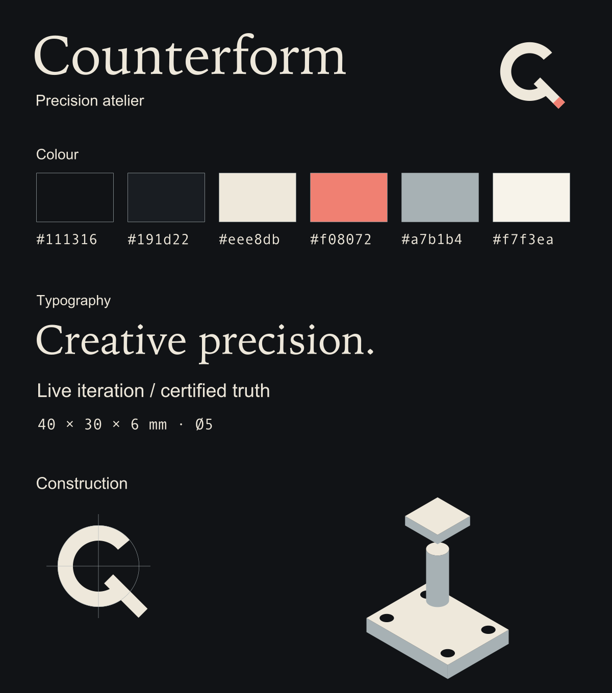
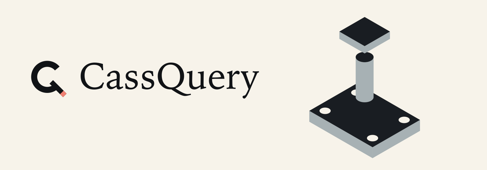

# CassQuery — Counterform

## 1. Three philosophies, before form

1. **Counterform / precision atelier — selected.** The void is as intentional as the solid. An open C becomes a Q through one measured incision. Warm editorial typography, bone against ink, and a small coral cut make the tool feel authored rather than industrial. Exact geometry is the visual grammar; creative iteration and certified truth remain distinct product states.
2. **Section / technical editorial.** Cutaway sections, dimension rules, and quieter Swiss typography make semantic inspection explicit. Rejected as the primary identity: useful for supporting diagrams, but too close to a utilitarian instrument panel.
3. **Afterimage / kinetic studio.** Offset contours and translucent iterations express the live loop. Rejected as the primary identity: motion and layered ambiguity can suggest unfinished truth; no such effects stand for certification.

Counterform is post-gendered, editorial, and restrained: creative precision with tempered hedonism. No developer cubes, braces, neon gradients, gear teeth, copied logos, military instrument styling, or masculine-coded gadget language.



## 2. Exact palette and typography

- **Ink** `#111316`: primary dark canvas and light-mode ink.
- **Panel** `#191d22`: elevated dark surfaces.
- **Bone** `#eee8db`: primary dark-mode foreground.
- **Coral** `#f08072`: incision only, not the main colour field.
- **Mist** `#a7b1b4`: secondary detail and silhouette sides.
- **Ivory** `#f7f3ea`: light-mode canvas.

UI stacks, local only:

```css
--font-heading: "Iowan Old Style", "Palatino Linotype", Georgia, serif;
--font-body: -apple-system, BlinkMacSystemFont, "Segoe UI", sans-serif;
--font-measure: "SFMono-Regular", Consolas, "Liberation Mono", monospace;
```

Brand wordmark: **Iowan Old Style Roman**, frozen as vector outlines from the local system font. The guide's sans and measurement specimens are frozen local Arial and Andale Mono outlines; they illustrate the roles, not a requirement to ship those font files. No font binary, external URL, downloaded typeface, or runtime font-rendering dependency is included. Banners, marks, wordmarks, and the guide contain **no SVG `<text>`**: metrics cannot change when a reader lacks Iowan. Descriptive `<title>` and `<desc>` preserve image accessibility; host pages should still use meaningful image alt text.

The logo never becomes a certification badge. Coral may echo preview iteration, but certified truth requires the product's explicit status label and semantic state tokens. Decorative geometry is illustrative; it is not gate evidence. In the light theme use ink, not mist or coral, for small text; the accent is decoration, not a body-text colour.

## 3. Brand math

The original C/Q master is a **100-unit field**:

- Centre `(48, 48)`; outer radius `32`; inner radius `20`; annular thickness `12`.
- Open mouth spans **±40°** about the positive x-axis. SVG y increases downward.
- Terminal centreline `(56, 58)` to `(83, 85)`: a **45° incision**, width `10`, length `27√2`.
- Coral occupies the last **22%** of the terminal length, from `(77.06, 79.06)` to `(83, 85)`. It is optional: monochrome is a complete identity.
- 16/24/32-pixel icons use an optical variant: inner radius `18`, bone terminal with no coral, larger mark scale `8.8` on the 1024-unit icon field. Larger icons use radius `20`, coral, and scale `8`.
- Normal app-mark transform: `(x, y) → (128 + 8x, 116 + 8y)`. Optical transform: `(x, y) → (89.6 + 8.8x, 77.6 + 8.8y)`.


The macOS plate is an opaque ink **superellipse**, exponent `5`, centred `(512, 512)` in a 1024-unit field, semiaxes `448`. Thus the extreme plate bounds are `[64, 960]` on each axis; pixels outside the macOS plate are transparent. Ink is full-bleed *inside the plate*—not a bordered mini-card, nested icon tile, or copied existing application logo. The plate uses 256 sampled perimeter points; the open annulus uses 144 samples per arc. No bevel, shadow, gradient, frame, or textured background is needed to recognise the mark.

Clear space: preserve at least `12` master units around the standalone mark when composing new work. Do not rotate, skew, stretch, add a stroke, close the mouth, or recolour the whole mark coral. At less than 32 pixels use the optical mono export. The README lockup has at least 24 pixels outer artwork margin; the standalone 920 × 200 wordmark lockup has at least 20 pixels outer margin, including its Q and y descenders.

## 4. Public supporting geometry

The supporting motif is the repository's **TESTPLATE**, from [`testpart/part_entry.py`](../testpart/part_entry.py):

- Base `40 × 30 × 6 mm`, four `Ø5 mm` bores at `(±15, ±10)`.
- Post `Ø8 × 22 mm`, actual base offset `z = 6 mm`.
- Cap `16 × 16 × 4 mm`, actual base offset `z = 28 mm`.

The illustration separates the post and cap by **10 mm display gaps**. It preserves part dimensions; it is not an assembled engineering drawing. Projection is `screen_x = x₀ + s cos(30°)(x − y)`, `screen_y = y₀ + s((x + y)/2 − z)`. The visible cylindrical side uses angular arc `−45° … 135°`, reaching the true horizontal ellipse extrema; the top ellipse and shaft have matching projected width. Bores are silhouette voids, not an invented private CAD scene.




Only this public fixture's dimension literals and silhouettes enter brand generation. No worker payload, model screenshot, private project source/name, imported build result, or existing application's logo is used. Source checks compare those literals against the fixture's parsed syntax without importing CadQuery.

## 5. Source and asset manifest

**Canonical source:** [`branding/source/counterform.json`](../branding/source/counterform.json) stores palette, mark parameters, plate parameters, public fixture dimensions, exact Iowan wordmark Bézier outlines, and flattened glyph contours. [`branding/source/labels.json`](../branding/source/labels.json) stores the guide's frozen outlined specimens. The generator is [`tools/make_brand_assets.py`](../tools/make_brand_assets.py). JSON is compact vector data, not a font binary or model payload.

**Machine manifest:** [`assets/brand-manifest.json`](../assets/brand-manifest.json) lists every generated asset's path, byte size, SHA-256, and both source hashes. There are **41 listed assets plus the manifest: 42 outputs**. The manifest cannot hash itself. Family inventory:

- `branding/mark{,-dark,-mono,-mono-dark}.svg`: 100 × 100 standalone C/Q variants.
- `viewer/brand.svg`: exact bone monochrome master for the viewer header; light mode may invert to ink.
- `branding/wordmark-{dark,light}.svg`: 920 × 200 transparent lockups.
- `branding/readme-{dark,light}.{svg,png}`: 1600 × 560 complete banner compositions.
- `branding/social-preview.{svg,png}`: 1200 × 630 composition, not a stretched banner.
- `branding/style-guide.{svg,png}`: 1200 × 1360 visual palette/type/construction sheet.
- `assets/icons/cassquery.svg`: 1024 × 1024 vector app icon master.
- `assets/icons/cassquery-{16,24,32,48,64,128,256,512,1024}.png`: RGBA app rasters.
- `assets/icons/cassquery.iconset/`: Apple's ten standard 1×/2× raster filenames, through 512@2×.
- `assets/icons/cassquery.ico`: seven PNG-backed 16/24/32/48/64/128/256 entries.
- `assets/icons/cassquery.icns`: native `ic04/ic05` premultiplied ARGB RLE entries at 16/32; native/Retina `ic07/ic08/ic09/ic10/ic11/ic12/ic13/ic14` PNG-backed entries, through 1024 pixels. Small native chunks deliberately do not use `icp4/icp5`: the actual macOS decoder misinterpreted those PNG payloads despite accepting the container.
- `assets/icons/favicon.svg`, `favicon.ico`, `favicon-{16,32}.png`: opaque ink, optical bone mark without a miniature nested plate. ICO has seven sizes through 256.

Parent integration owns README, package scripts, icon packaging and interface tokens; the brand generator changes none of those. The single new viewer asset is explicitly permitted. Banners are presentation assets, not UI helper-text exceptions.

## 6. Deterministic reproduction

Runtime dependencies: **none**. Asset-development dependency: **Pillow 13.0.0**, exact-pinned in [`branding/requirements.txt`](../branding/requirements.txt). Fonts, fontTools, Qt, Electron, iconutil, CadQuery, network access, locale and system clocks are not generation inputs. Frozen SVG Bézier paths and pre-flattened contours eliminate font-version substitution. Raster export uses **4×4 integer area coverage**, not a platform resampling filter. Each polygon coordinate is serialized to the SVG contract's **four decimal places**, parsed as integer 1/10,000-unit values, and mapped to integer coverage pixels by exact rational scaling/floor before bounds and drawing. Pillow receives only integer row spans: polygon coverage is computed by an **exact Fraction-based scanline converter** at pixel centres, using half-open edge activity and even-odd fill. Its platform C polygon scanner is not used. Painted fills have binary opaque coverage; integer channel sums reconstruct straight alpha with specified rounding. This removes platform-specific polygon scan-conversion ties: primary Mac/Linux evidence showed identical quantized contours and integer input points but differing supersampled masks at 7/8 banner edge pixels before replacing the C scan converter. PNG serialization is explicit: RGBA8, filter-zero scanlines, fixed 65,535-byte stored DEFLATE blocks, Adler32 and chunk CRC checksums, no metadata/timestamp, and no linked compressor. This trades compression for reproducible bytes (~37.1 MB across duplicated icon/container exports). ICO and the large ICNS representations reuse the exact PNG bytes. Small native ICNS representations use deterministic literal-only per-channel ARGB RLE with premultiplied colour channels.

```sh
# Use an existing scratch venv with the pinned Pillow or create one outside source.
python -m pip install -r branding/requirements.txt
python tools/make_brand_assets.py
python tools/make_brand_assets.py --check
python -m unittest discover -s tests -p test_brand_assets.py -v
npm run check
```

`--check` regenerates in memory, compares **every output byte**, fails on a missing/stale output, and writes nothing. An incompatible/missing Pillow fails with an explicit dependency error rather than silently using another renderer. Standard-library manifest/SVG/container/layout/drift tests run even without Pillow; the full regeneration test then reports an explicit skip. CI must install the pin and run `--check`, not treat that skip as reproducibility proof. The explicit PNG writer removes linked zlib compression differences; Pillow's raster implementation and floating-point projection still require a real check on a different host. The version string alone is not cross-platform proof.

## 7. Checked / not checked

**Checked on the Mac development host:** seventeen branding regressions; all 42 outputs compared byte-for-byte; `npm run check`; SHA-256/length checks; SVG accessibility and no external/text/script content; public fixture literal matching; C/Q optical variants; banner/wordmark bounds; projected cylinder extrema; deterministic PNG stored-block protocol; all ICO and ICNS entry sizes/bytes. The actual `iconutil --convert iconset` roundtrip checked all ten decoded standard filenames: alpha, opaque RGB and premultiplied RGBa are exact; the 16/32 native representations differ only in straight-RGBA unpremultiplication rounding (compositing ≤1 channel unit on ink and ivory). Native Retina/128+ representations preserve raw RGBA exactly. `sips` reported 1024 × 1024. Container acceptance alone is explicitly not a pixel gate.

**Cross-host checked:** the final exact-scanline generator ran on Linux x86-64 with fbpython/CPython 3.12 and Pillow 13.0.0. **All 42 outputs matched the Mac exports byte-for-byte.** The 17-test suite passed 16 tests there; the macOS-only native iconutil pixel gate was explicitly skipped and separately passed on the Mac (17/17). This is an actual alternate-host result, not an inference from equal version strings.

**Render-checked:** eight shipped SVG compositions decoded independently using Qt 6.9.3 `QSvgRenderer` into QImage, without a QGuiApplication or Electron window. Actual raster images of both banners, both wordmarks, social card, style guide, app icon and viewer mark were inspected; Pillow PNG outputs and 16/24/32/48/64/128 actual-size and 16/32 enlarged icon contact sheets were also inspected. Source SVGs and rasters have legible typography, separated text/geometry, intact counters and unclipped descenders. Review evidence lives only under ignored `evidence/brand/`; it is not a shipping asset.

**Independent review:** a separate source/geometry/container review identified and corrected two substantive defects: the cylinder's projected-side arc, and native 16/32 ICNS chunks that decoded as noise although the container was accepted. Dedicated regressions now check shaft/top width and actual macOS-decoded pixels. The reviewer independently repeated native decoding, verified all ten representations, inspected the corrected source/Qt/PNG artwork, and measured tiny-icon compositing on ink and ivory. Independent final disposition: **PASS, no unresolved confirmed defects**. The review also decoded all 25 PNGs, both seven-size ICOs, verified all frozen label/wordmark outlines against the stated local font sources, and ran a real no-mock `--check` corruption/missing/source-drift probe. Every check invocation preserved existing hashes and modification times. The final exact scan converter was independently verified with a separate integer-cross-product point oracle: **17,856 pixels across 124 concave, self-crossing, degenerate, clipped and reverse-winding polygons**, plus cleared holes, matched exactly. Final Mac `--check`, 17 tests, native icon decoding and new PNG visual inspection passed; the alternate-host proof above closes the cross-host gate. Independent report: ignored `evidence/brand/review/REPORT.md` and `determinism-contract.json`.

**Not claimed here:** native packaged Electron launch, Dock/Finder cache refresh, installed-app icon presentation, clean-machine/minimum-macOS launch, signing/notarization, untested platforms beyond the checked Mac/Linux pair, or public distribution. Native GUI launch remains blocked by the host's Mach rendezvous permission; no security bypass was attempted. Release gates in [`MACOS_RELEASE.md`](MACOS_RELEASE.md) still apply. Nothing was committed, pushed, published, or sent to another person.
